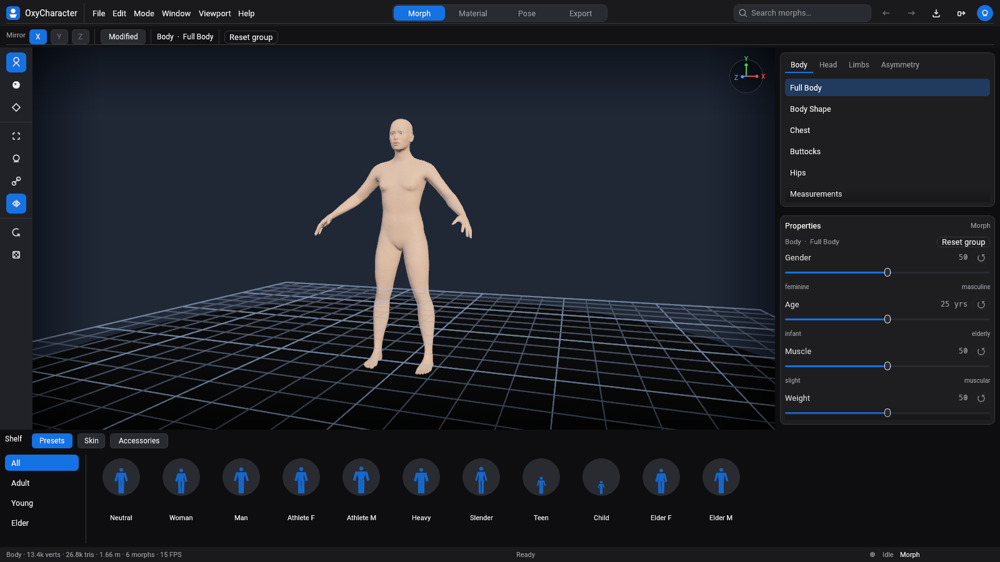
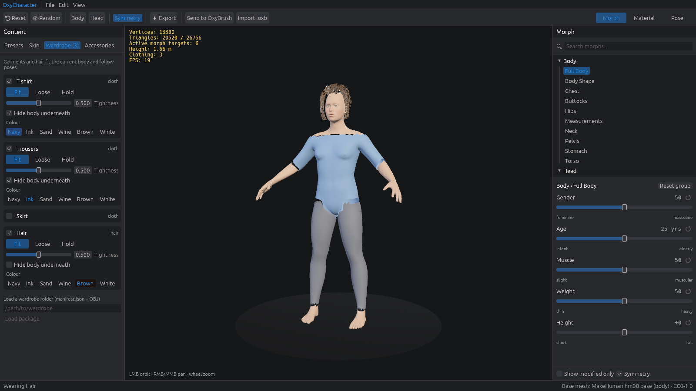
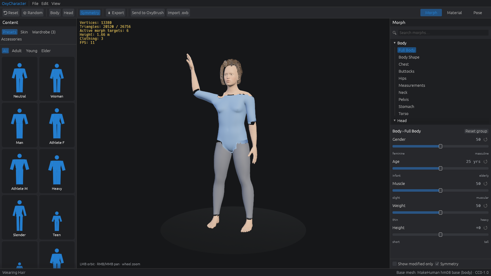
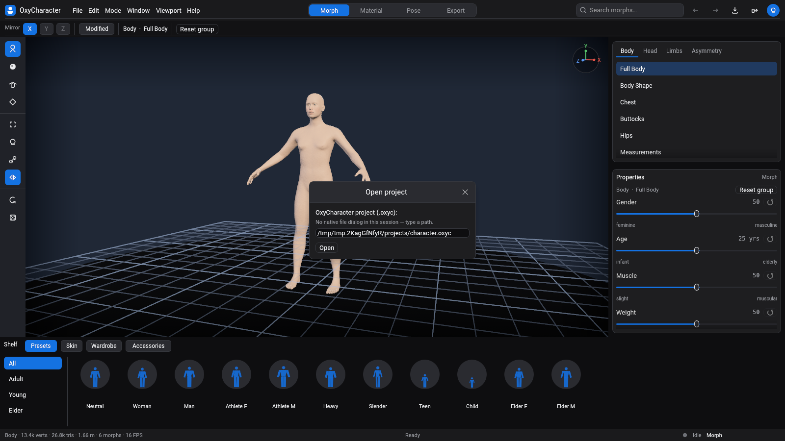

# OxyCharacter

A clean-room, Rust-native parametric 3D character creator: shape a base human
with sliders, auto-refit its skeleton, dress it, and export rigged glTF.



- **[docs/ROADMAP.md](docs/ROADMAP.md)** — status, next milestones, known gaps
- **[docs/PLAN.md](docs/PLAN.md)** — scope, architecture and algorithms
- **[CONTRIBUTING.md](CONTRIBUTING.md)** · **[AGENTS.md](AGENTS.md)** (AI agents) · [docs/TESTING.md](docs/TESTING.md) · [docs/CLEAN_ROOM.md](docs/CLEAN_ROOM.md) · [CHANGELOG.md](CHANGELOG.md)

## Download

Prebuilt packages are published on [GitHub Releases](https://github.com/crisprintsstuff/OxyCharacter/releases) when a `v*` tag is pushed. The first version prepared in this tree is **v0.0.1-alpha**. Until that tag is pushed there is nothing to download; build from source under [Quick start](#quick-start). Notes for that version: [docs/release-notes/v0.0.1-alpha.md](docs/release-notes/v0.0.1-alpha.md).

Each archive contains the editor (`oxycharacter`), the CLI (`oxy`), the CC0 character bundle, and the licence files. The programs do not download the bundle. `SHA256SUMS.txt` on the release lists the checksums.

| Platform | File |
|---|---|
| Windows, install (Start Menu and uninstaller) | `OxyCharacter-v0.0.1-alpha-windows-x86_64-setup.exe` |
| Windows, portable zip | `OxyCharacter-v0.0.1-alpha-windows-x86_64.zip` |
| macOS, Apple Silicon and Intel | `OxyCharacter-v0.0.1-alpha-macos-universal.dmg` |
| Linux x86_64 archive | `OxyCharacter-v0.0.1-alpha-linux-x86_64.tar.gz` |
| Linux x86_64 AppImage | `OxyCharacter-v0.0.1-alpha-linux-x86_64.AppImage` |

**Windows.** Run the setup exe for a per-user install (no administrator prompt), a Start Menu entry and an uninstaller. Projects then live in `%APPDATA%\OxyCharacter`. Or unzip the portable zip and run `oxycharacter.exe`; that folder has a `portable` marker, so projects stay in a `user` directory next to the exe. From any directory: `oxy info makehuman.oxyb`.

**macOS.** Open the disk image and drag **OxyCharacter** to Applications. The command-line tool is `OxyCharacter.app/Contents/MacOS/oxy`. Builds are ad-hoc signed unless the project has configured Developer ID secrets, so Gatekeeper will block a downloaded app the first time. Right-click the app, choose **Open**, then **Open** again. Or, in Terminal:

```sh
xattr -dr com.apple.quarantine /Applications/OxyCharacter.app
```

**Linux.** Extract the tar.gz and run `./oxycharacter`. The archive is portable (`user/` beside the binaries). The AppImage launches the editor; `./OxyCharacter-v0.0.1-alpha-linux-x86_64.AppImage oxy info makehuman.oxyb` runs the CLI. The AppImage stores projects under `$XDG_DATA_HOME/oxycharacter` or `~/.local/share/oxycharacter`.

You need a Vulkan driver. The packages were built on GitHub-hosted runners and the Linux editor was smoked under lavapipe; a Windows or macOS desktop GPU has not been tried.

## Quick start

```sh
# 1. Fetch the CC0 base mesh + morph targets and build the binary bundle (~50 MB)
tools/fetch-assets.sh

# 2. Run the editor
cargo run --release -p oxy-app
```

Headless tools:

```sh
cargo run --release -p oxy-cli -- info   assets/generated/makehuman.oxyb
cargo run --release -p oxy-cli -- export assets/generated/makehuman.oxyb out.glb gender=1 muscle=0.8
```

Editor options (useful for scripted screenshots / smoke tests):

```sh
oxycharacter --set gender=1 --select Head/Nose --hover nose/nose-scale-horiz-decr-incr \
             --head --screenshot shot.png --frames 40
oxycharacter --dialog open --screenshot dialog.png --frames 40   # typed-path dialog, no portal window
```

Linux without a GPU: `Xvfb :99 & DISPLAY=:99 VK_ICD_FILENAMES=/usr/share/vulkan/icd.d/lvp_icd.json oxycharacter …`
(needs `mesa-vulkan-drivers`).

## Scripts

A plugin is a `.rhai` file you write. It can change sliders, pose, the built-in wardrobe, skin and eyes, and it can register a named action. Drop files in the `plugins` folder under the user directory (`OXY_PLUGINS` overrides that folder). The editor's **Scripts** menu lists every `action`. Headless:

```sh
oxy script assets/generated/makehuman.oxyb plugins/hero.rhai
oxy script assets/generated/makehuman.oxyb plugins/hero.rhai --call hero
oxycharacter --script plugins/hero.rhai --call hero
```

Every host function, the limits, and a full example are in [docs/scripting.md](docs/scripting.md). Scripts cannot read files or use the network.

## Editor

The window uses the same dark chrome as OxyBrush: a menu and a centered
**Morph / Material / Pose / Export** switch, a tool-options bar, an icon rail,
the viewport, a stacked inspector, a bottom shelf and a status bar.

- **Shelf:** body presets (procedural silhouette cards), skin-tone swatches
  plus a custom color, the **wardrobe** (clothing and hair) and OxyBrush
  accessories. The rail opens the same pages.
- **Viewport:** orbit (LMB), pan (RMB/MMB), zoom (wheel). Mesh stats sit in the
  status bar. Hovering or dragging a slider tints the region it affects.
- **Morph:** search (top bar), category tabs with modified counts, sliders with
  a value readout, reset and range-end labels. Symmetry links left and right
  (the X axis). Double-click resets a slider. "Modified" hides untouched sliders.
- **Material, Pose, Export:** the other modes. Reset, randomize and framing stay
  on the rail and the menus. Export asks for a `.glb` path (the suggestion is
  `exports/<project>.glb`) and includes whatever is worn.


## Skin and eyes

**Material** mode sets the look. Skin is **procedural**: a
layer stack (tone, variation, freckles, blush, eye shadow, lips, surface
detail, roughness) baked into albedo, normal and roughness textures over the
body's UVs. Face regions come from the rig's face-bone weights, so they follow
any face shape. Eyes are generated eyeballs on the rig's eye bones with a
procedural iris (presets or any colour). No image files are needed; exports
embed the baked textures (1024–4096 px) and pass the glTF validator.


## Clothing and hair

The **Wardrobe** page (rail icon, and the chip on the shelf) puts clothes and hair on the character. A T-shirt,
trousers, a skirt and hair are generated from the body (nothing is downloaded
for them). They **refit when the body changes** and **skin with the skeleton**
when you pose.

- **Fit** keeps a gap off the skin. **Loose** (the skirt) follows the body's
  overall shape instead of hugging the legs. **Hold** does not refit.
- **Tightness** pulls an item in or lets it stand off. The middle is the
  shape it was made at.
- **Hide body underneath** drops body triangles that sit fully under the
  item. A shirt on top of trousers hides the waistband where they overlap.
- Hair is a set of cards with a strand texture. Pick a colour from the
  swatches.
- **Load package** reads a folder of `manifest.json` plus OBJ meshes.
  Pieces that come back from OxyBrush are fitted when they sit on the body,
  and left as props when they don't.

Worn items are saved in the project and undo with everything else. Export
includes them as skinned meshes; hair keeps its strand texture.

```sh
oxycharacter --wardrobe-tab --wear tee,pants,hair --screenshot dressed.png --frames 40
oxy wardrobe assets/generated/makehuman.oxyb
oxy export assets/generated/makehuman.oxyb hero.glb --wear tee,pants,hair --tpose
```





## Projects, undo and autosave

- **File › New / Open / Open recent / Save / Save as** — projects are small,
  human-readable JSON files (`.oxyc`): only the sliders you changed, skin,
  pose and export options, plus any sculpted morphs, worn clothing and accessories, so a
  project is self-contained. A fingerprint of the base mesh guards against
  opening a project on a different body (sculpts are then skipped with a note).
- **Undo / redo** for every edit; a slider drag is one step.
- The title shows `*` for unsaved changes; New, Open and closing the window
  ask before discarding them.
- **Autosave** every minute while there are unsaved changes; after a crash
  the next start offers to recover.

| Shortcut | Action |
|---|---|
| Ctrl+Z / Ctrl+Shift+Z (or Ctrl+Y) | Undo / redo |
| Ctrl+S / Ctrl+Shift+S | Save / save as |
| Ctrl+O / Ctrl+N | Open / new |

Open, Save as, glTF export and Import .oxb use the system file dialog when the
desktop provides one (an XDG file chooser on Linux), with filters for `.oxyc`,
`.oxb` and `.glb`. Open starts in the most recent project's folder, Save as
in the current file's folder, export in `exports/`, and import in
`user/oxybrush/` when that folder exists. **Open recent** stays in the File
menu. If there is no native dialog (a headless session, or Linux without the
portal), the same actions use a small path field that still lists recent
projects. `OXY_FILE_DIALOG=fallback` forces that field; `=native` forces the
system dialog.




## Rig, poses and export

The character carries a 163-bone skeleton (the CC0 MakeHuman default rig:
body, fingers, toes and face) that **refits to every morph**: joints are
averages of points that the morph targets move, including sculpts brought
back from OxyBrush.

- **Pose** mode: preview poses (*Rest/A-pose, T-pose, Relaxed, Wave, Stride*)
  with linear-blend skinning, and *Show skeleton*. **Export** mode holds the
  glTF options.
- **Export (.glb)**: skeleton + skin weights (4 per vertex), bind pose
  *Rest* or *T-pose*, sculpted morphs baked or as named **blendshapes**,
  clothing and hair fitted to the body, accessories skinned with the
  skeleton (fitted pieces follow the body; props use the nearest vertex).


Exports pass the Khronos glTF validator with no errors or warnings, and load
and deform in three.js. The same files were imported headless in **Blender
4.0.2** and **Godot 4.7.2** (`tools/check-gltf-engines`): static mesh,
rigged rest pose, T-pose bind, a blendshape, embedded textures (albedo,
normal, roughness, iris) and a skinned accessory. In both engines the bind
pose reproduces the mesh, skin weights sum to 1, rotating the upper arm and
the eye bone deforms the body and eyeball, the T-pose left wrist stays level
with the shoulder, and the shape key moves vertices. Godot renames mesh
nodes that contain `.` (`eye.L` → `eye_L`) and keeps the bone names
(`upperarm01.L`). Unity and Unreal have not been run.

```sh
oxy export assets/generated/makehuman.oxyb hero.glb --tpose --texture-size 2048 gender=1 muscle=0.7
oxy export assets/generated/makehuman.oxyb hero.glb --blendshapes --morphs user/morphs
oxy export assets/generated/makehuman.oxyb hero.glb --wear tee,pants,hair --tpose
oxy export assets/generated/makehuman.oxyb hero.glb --accessory hat.obj
```

## Sculpting in OxyBrush

OxyCharacter round-trips with [OxyBrush](https://github.com/crisprintsstuff/OxyBrush)
through its native `.oxb` project files: no export/import dance, no shared code.

1. **Send to OxyBrush** (top bar or File menu) writes the current character to
   `user/oxybrush/character-<time>.oxb` and opens it in OxyBrush
   (`$OXYBRUSH_BIN`, else `oxybrush` on `PATH`; if neither starts, open the file yourself).
2. Sculpt the body, add new pieces (hats, hair, props…), and **save** (Ctrl+S).
3. OxyCharacter notices the save and shows **Import from OxyBrush**:
   - the reshaped **body becomes a morph slider** under *Custom › Sculpted*
     (saved to `user/morphs/` and reloaded on start; 🗑 deletes it);
   - **new pieces become accessories** (shelf → *Accessories*). A piece that
     sits on the body is fitted to later shape changes; one held away only
     follows the skeleton. Both export with the body.

You can also import any `.oxb` with **Import .oxb** or by dropping it on the window.

How it works: OxyBrush re-sorts vertices when it loads a mesh, so OxyCharacter
recovers the vertex correspondence from mesh connectivity (≈30–60 ms for the
13k-vertex body) and measures the sculpt against the body it sent (parameters
are kept in a `.oxylink.json` file next to the `.oxb`). Files saved by OxyBrush ≥ 2.5.8 carry a vertex map (`VMAP`) that gives the
correspondence exactly; it is checked against the topology and the matcher is
the fallback. Sculpting on
**subdivision levels** (Ctrl+D in OxyBrush) is fine: level 0 becomes the
morph; detail finer than the base mesh stays in OxyBrush for now. Remeshing or
destructive subdivision changes the topology, so such a body can only come
back as a separate mesh. See [ADR 0004](docs/adr/0004-oxybrush-bridge.md).

The two shots below are from the earlier OxyBrush bridge session. OxyBrush is not in this environment, so they still show the window chrome from before the family restyle.


Headless equivalents:

```sh
oxy send-oxybrush   assets/generated/makehuman.oxyb out.oxb gender=1
oxy import-oxybrush assets/generated/makehuman.oxyb out.oxb --save-morphs user/morphs
```

## Status

| Milestone | State |
|---|---|
| M0 foundations | ✅ |
| M1 see a human (import, bundle, editor, static glTF export) | ✅ |
| OxyBrush bridge (send, live re-import as morphs/accessories) | ✅ |
| M2 rigged & exportable (skeleton refit, poses, skinned glTF, T-pose bind, blendshapes) | ✅ |
| M3 project files, undo/redo, autosave & recovery | ✅ |
| M4 materials (UVs, procedural skin, eyes, textured glTF) | ✅ |
| M5 clothing & hair (fit, hide-under, hair cards, export) | ✅ |

| Crate | What it does |
|---|---|
| `oxy-mesh` | Mesh, sparse morph targets, blending, normals, topology correspondence |
| `oxy-morph` | Sliders, macro grids with gains, parameter catalog |
| `oxy-rig` | Joints anchored to body/aux points, bones, posing, skinning, weight transfer, pose presets |
| `oxy-io` | OBJ / sparse-target import, MakeHuman CC0 importer, `.oxyb` bundle, `.glb` export, `.oxb` read/write, OxyBrush bridge |
| `oxy-material` | UV rasterizer, 3D noise, layer stack, skin regions from bone weights, texture encoding, eyeballs + iris |
| `oxy-project` | `.oxyc` project format (versioned, migrations, base fingerprint), snapshot undo history |
| `oxy-fit` | Clothing and hair: bind, refit, loose radial-basis fit, weight transfer, hide-under |
| `oxy-script` | Rhai plugins: sliders, pose, wardrobe, skin and eyes |
| `oxy-cli` | `oxy` command-line tool |
| `oxy-app` | Bevy + egui editor (`oxycharacter`) |

```sh
cargo test --workspace
# include the real-data integration test:
OXY_MAKEHUMAN_DATA=assets/cache/makehuman/makehuman/data cargo test --workspace --release
```

Assets and their licenses: [assets/LICENSES.md](assets/LICENSES.md).

## License

Code: MIT OR Apache-2.0 ([LICENSE-MIT](LICENSE-MIT), [LICENSE-APACHE](LICENSE-APACHE)).
Fetched assets keep their own licences (CC0 for the MakeHuman data); see
[assets/LICENSES.md](assets/LICENSES.md).
