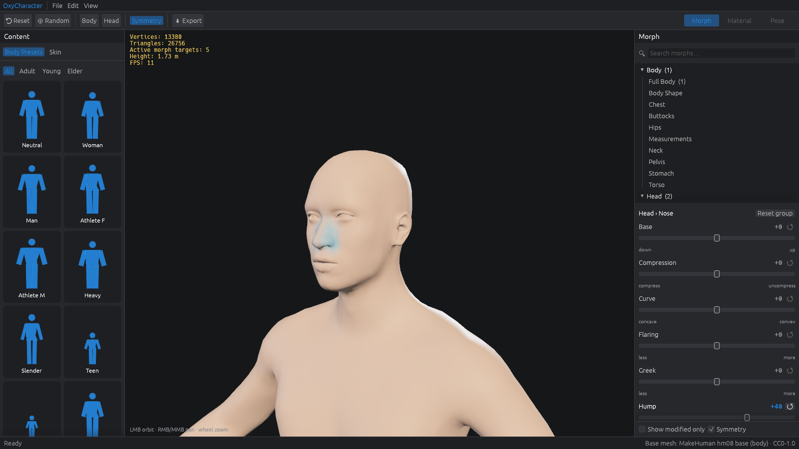
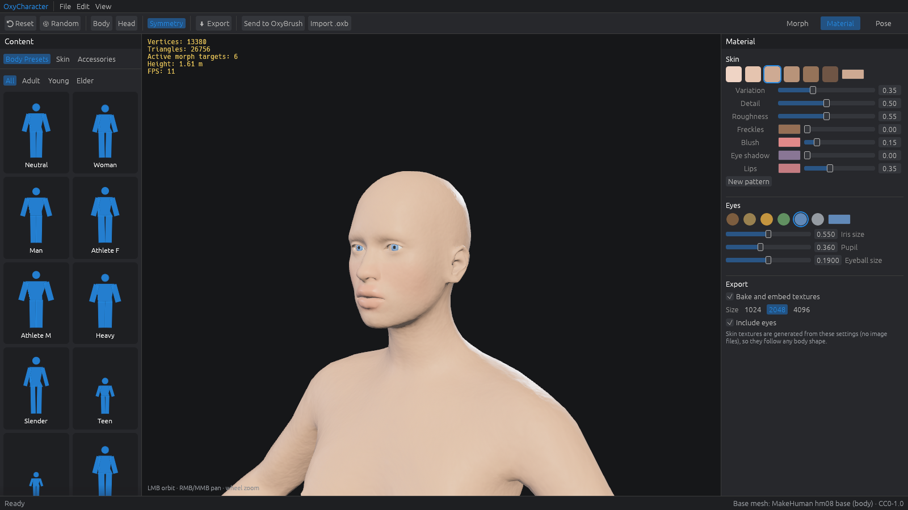
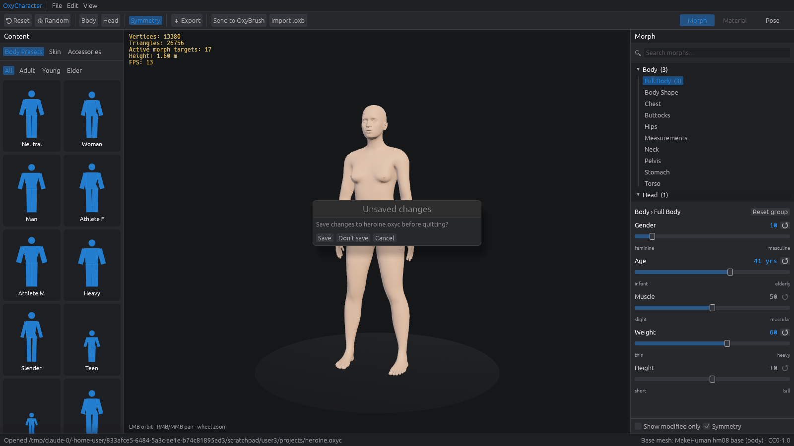
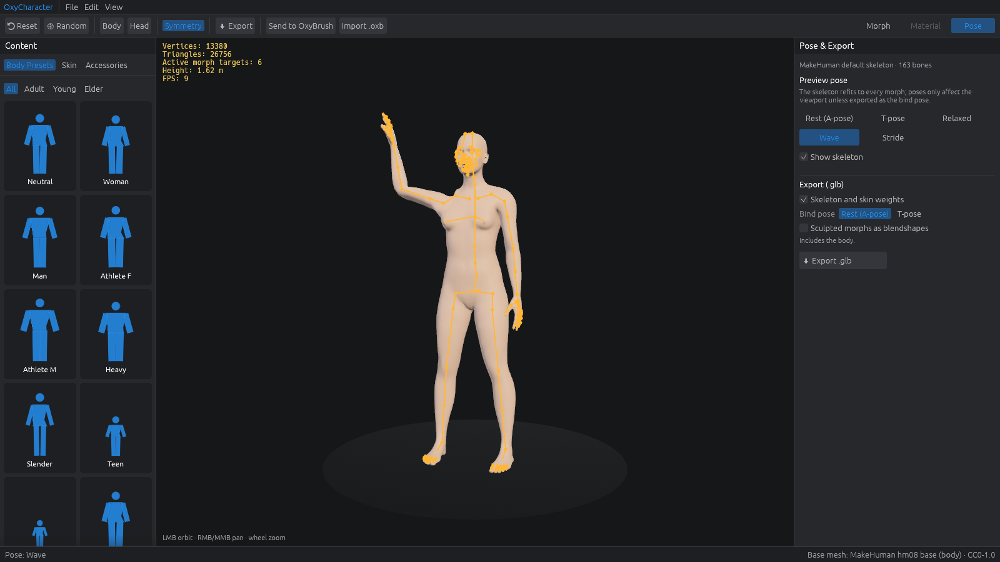
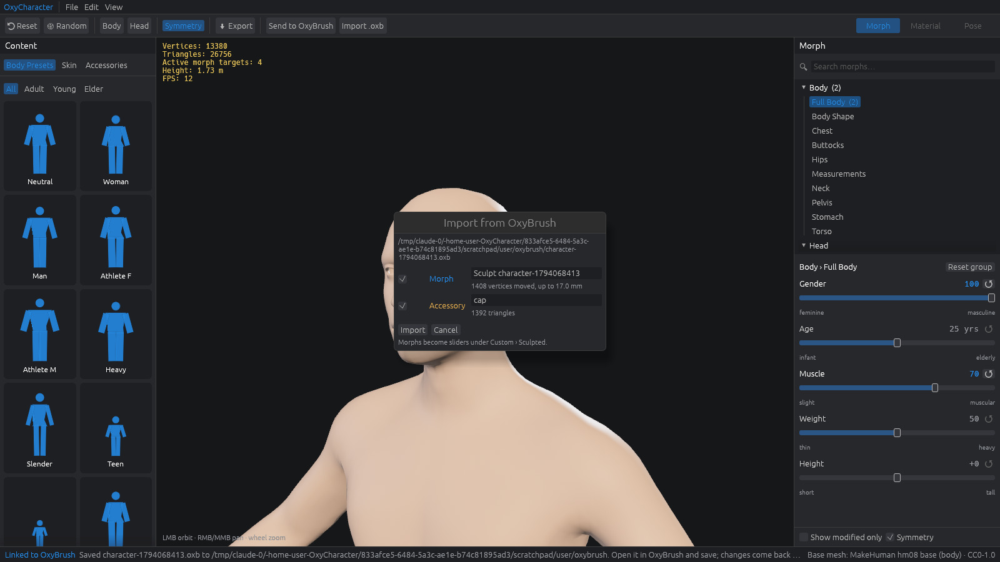
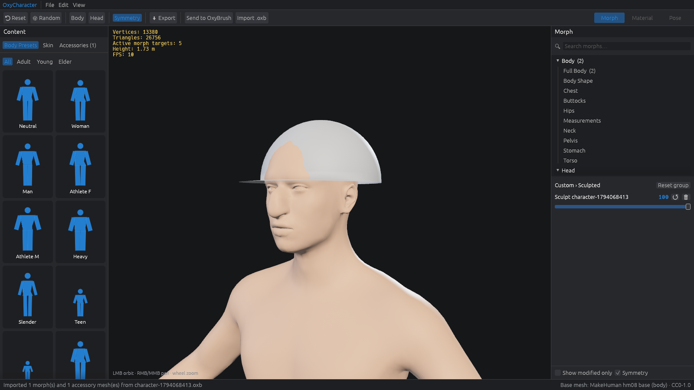

# OxyCharacter

A clean-room, Rust-native parametric 3D character creator: shape a base human
with sliders, auto-refit its skeleton, dress it, and export rigged glTF.


- **[docs/ROADMAP.md](docs/ROADMAP.md)** — status, next milestones, known gaps
- **[docs/PLAN.md](docs/PLAN.md)** — scope, architecture and algorithms
- **[CONTRIBUTING.md](CONTRIBUTING.md)** · **[AGENTS.md](AGENTS.md)** (AI agents) · [docs/TESTING.md](docs/TESTING.md) · [docs/CLEAN_ROOM.md](docs/CLEAN_ROOM.md) · [CHANGELOG.md](CHANGELOG.md)

## Quick start

```sh
# 1. Fetch the CC0 base mesh + morph targets and build the binary bundle (~50 MB)
tools/fetch-assets.sh

# 2. Run the editor
cargo run --release -p oxy-app
```

Headless tools:

```sh
cargo run --release -p oxy-cli -- info   assets/generated/makehuman.oxyb
cargo run --release -p oxy-cli -- export assets/generated/makehuman.oxyb out.glb gender=1 muscle=0.8
```

Editor options (useful for scripted screenshots / smoke tests):

```sh
oxycharacter --set gender=1 --select Head/Nose --hover nose/nose-scale-horiz-decr-incr \
             --head --screenshot shot.png --frames 40
```

Linux without a GPU: `Xvfb :99 & DISPLAY=:99 VK_ICD_FILENAMES=/usr/share/vulkan/icd.d/lvp_icd.json oxycharacter …`
(needs `mesa-vulkan-drivers`).

## Editor

- **Content** (left): body presets with procedural silhouette cards, skin-tone swatches + custom color.
- **Viewport** (center): orbit (LMB), pan (RMB/MMB), zoom (wheel); stats overlay.
- **Morph** (right): search, category tree with modified counts, sliders with value
  readout, reset and range-end labels. Hovering or dragging a slider tints the
  region it affects. Symmetry links left/right sliders. Double-click resets a slider.
- **Toolbar**: reset, randomize, body/head framing, symmetry, glTF export (to `exports/`).



## Skin and eyes

The **Material** tab (top right) sets the look. Skin is **procedural**: a
layer stack (tone, variation, freckles, blush, eye shadow, lips, surface
detail, roughness) baked into albedo, normal and roughness textures over the
body's UVs. Face regions come from the rig's face-bone weights, so they follow
any face shape. Eyes are generated eyeballs on the rig's eye bones with a
procedural iris (presets or any colour). No image files are needed; exports
embed the baked textures (1024–4096 px) and pass the glTF validator.



## Projects, undo and autosave

- **File › New / Open / Open recent / Save / Save as** — projects are small,
  human-readable JSON files (`.oxyc`): only the sliders you changed, skin,
  pose and export options, plus any sculpted morphs and accessories, so a
  project is self-contained. A fingerprint of the base mesh guards against
  opening a project on a different body (sculpts are then skipped with a note).
- **Undo / redo** for every edit; a slider drag is one step.
- The title shows `*` for unsaved changes; New, Open and closing the window
  ask before discarding them.
- **Autosave** every minute while there are unsaved changes; after a crash
  the next start offers to recover.

| Shortcut | Action |
|---|---|
| Ctrl+Z / Ctrl+Shift+Z (or Ctrl+Y) | Undo / redo |
| Ctrl+S / Ctrl+Shift+S | Save / save as |
| Ctrl+O / Ctrl+N | Open / new |

File paths are typed into a small dialog for now (with recent files); native
file dialogs are planned.



## Rig, poses and export

The character carries a 163-bone skeleton (the CC0 MakeHuman default rig:
body, fingers, toes and face) that **refits to every morph**: joints are
averages of points that the morph targets move, including sculpts brought
back from OxyBrush.

- **Pose tab** (top right): preview poses (*Rest/A-pose, T-pose, Relaxed,
  Wave, Stride*) with linear-blend skinning, and *Show skeleton*.
- **Export (.glb)**: skeleton + skin weights (4 per vertex), bind pose
  *Rest* or *T-pose*, sculpted morphs baked or as named **blendshapes**,
  accessories skinned by nearest-vertex weight transfer.



Exports pass the Khronos glTF validator with no errors or warnings, and load
and deform in three.js. They have not yet been tried in Blender, Godot, Unity
or Unreal.

```sh
oxy export assets/generated/makehuman.oxyb hero.glb --tpose --texture-size 2048 gender=1 muscle=0.7
oxy export assets/generated/makehuman.oxyb hero.glb --blendshapes --morphs user/morphs
```

## Sculpting in OxyBrush

OxyCharacter round-trips with [OxyBrush](https://github.com/crisprintsstuff/OxyBrush)
through its native `.oxb` project files: no export/import dance, no shared code.

1. **Send to OxyBrush** (toolbar or File menu) writes the current character to
   `user/oxybrush/character-<time>.oxb` and opens it in OxyBrush
   (`$OXYBRUSH_BIN`, else `oxybrush` on `PATH`; if neither starts, open the file yourself).
2. Sculpt the body, add new pieces (hats, hair, props…), and **save** (Ctrl+S).
3. OxyCharacter notices the save and shows **Import from OxyBrush**:
   - the reshaped **body becomes a morph slider** under *Custom › Sculpted*
     (saved to `user/morphs/` and reloaded on start; 🗑 deletes it);
   - **new pieces become accessories** (left panel → *Accessories*), exported with the body.

You can also import any `.oxb` with **Import .oxb** or by dropping it on the window.

How it works: OxyBrush re-sorts vertices when it loads a mesh, so OxyCharacter
recovers the vertex correspondence from mesh connectivity (≈30–60 ms for the
13k-vertex body) and measures the sculpt against the body it sent (parameters
are kept in a `.oxylink.json` file next to the `.oxb`). Files saved by OxyBrush ≥ 2.5.8 carry a vertex map (`VMAP`) that gives the
correspondence exactly; it is checked against the topology and the matcher is
the fallback. Sculpting on
**subdivision levels** (Ctrl+D in OxyBrush) is fine: level 0 becomes the
morph; detail finer than the base mesh stays in OxyBrush for now. Remeshing or
destructive subdivision changes the topology, so such a body can only come
back as a separate mesh. See [ADR 0004](docs/adr/0004-oxybrush-bridge.md).





Headless equivalents:

```sh
oxy send-oxybrush   assets/generated/makehuman.oxyb out.oxb gender=1
oxy import-oxybrush assets/generated/makehuman.oxyb out.oxb --save-morphs user/morphs
```

## Status

| Milestone | State |
|---|---|
| M0 foundations | ✅ |
| M1 see a human (import, bundle, editor, static glTF export) | ✅ |
| OxyBrush bridge (send, live re-import as morphs/accessories) | ✅ |
| M2 rigged & exportable (skeleton refit, poses, skinned glTF, T-pose bind, blendshapes) | ✅ |
| M3 project files, undo/redo, autosave & recovery | ✅ |
| M4 materials (UVs, procedural skin, eyes, textured glTF) | ✅ |
| M5 clothing & hair | next |

| Crate | What it does |
|---|---|
| `oxy-mesh` | Mesh, sparse morph targets, blending, normals, topology correspondence |
| `oxy-morph` | Sliders, macro grids with gains, parameter catalog |
| `oxy-rig` | Joints anchored to body/aux points, bones, posing, skinning, weight transfer, pose presets |
| `oxy-io` | OBJ / sparse-target import, MakeHuman CC0 importer, `.oxyb` bundle, `.glb` export, `.oxb` read/write, OxyBrush bridge |
| `oxy-material` | UV rasterizer, 3D noise, layer stack, skin regions from bone weights, texture encoding, eyeballs + iris |
| `oxy-project` | `.oxyc` project format (versioned, migrations, base fingerprint), snapshot undo history |
| `oxy-cli` | `oxy` command-line tool |
| `oxy-app` | Bevy + egui editor (`oxycharacter`) |

```sh
cargo test --workspace
# include the real-data integration test:
OXY_MAKEHUMAN_DATA=assets/cache/makehuman/makehuman/data cargo test --workspace --release
```

Assets and their licenses: [assets/LICENSES.md](assets/LICENSES.md).

## License

Code: MIT OR Apache-2.0 ([LICENSE-MIT](LICENSE-MIT), [LICENSE-APACHE](LICENSE-APACHE)).
Fetched assets keep their own licences (CC0 for the MakeHuman data); see
[assets/LICENSES.md](assets/LICENSES.md).
