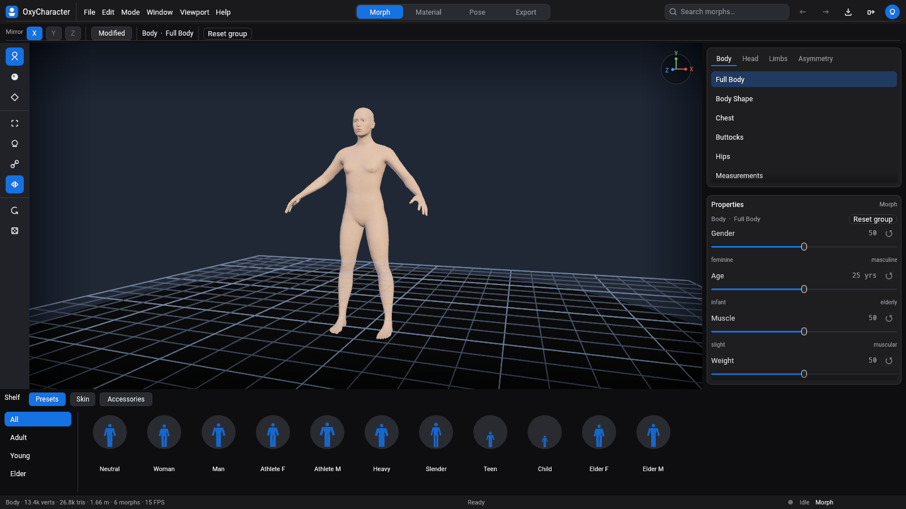

# OxyCharacter v0.0.1-alpha

First public build of OxyCharacter, a clean-room parametric 3D character creator. Shape a base human with sliders, the skeleton refits, give it an expression, dress it, and export a rigged glTF.



This is an **alpha**. The packages are built by GitHub Actions. Unless Apple signing secrets were configured for the run, the macOS app is only ad-hoc signed and is not notarized. Expect rough clothing edges and missing features; the list is below.

## Highlights

- **Body.** A CC0 base mesh and 328 sliders, including gender, age, muscle, weight and height, with symmetry, search, region highlight, presets and randomize.
- **Face.** 34 expression units (brows, eyes, nose, mouth, neck), 10 presets (smile, sad, angry, surprise, fear, disgust, wink, blink, kiss…), 11 mouth shapes for speech, and gaze. Expressions follow the face shape. Exports carry them as named blendshapes (`expr.*`, `face.*`, `viseme.*`), or bake the current one in.
- **Rig.** A 163-bone skeleton (body, fingers, toes, face) that refits to every morph. Pose presets (rest, T-pose, relaxed, wave, stride) and a skeleton overlay.
- **Export.** Skinned glTF (`.glb`) with a rest or T-pose bind, blendshapes (stored sparsely), and embedded textures. Checked with the Khronos validator (0 errors, 0 warnings) and loaded in three.js. The same kind of file was imported headless in **Blender 4.0.2** and **Godot 4.7.2**. Unity and Unreal have not been run.
- **Projects.** `.oxyc` files store the sliders you changed, plus skin, pose, expression, wardrobe and any sculpted morphs. Undo and redo, an unsaved-changes prompt, and autosave with crash recovery.
- **Skin and eyes.** Procedural skin (tone, variation, freckles, blush, lips, roughness) and generated eyes with a procedural iris. No image files are required; exports embed the bakes.
- **OxyBrush.** Send the character to [OxyBrush](https://github.com/crisprintsstuff/OxyBrush), sculpt, save, and bring the body back as a morph and new pieces as accessories.
- **Wardrobe.** Original T-shirt, trousers, skirt and hair cards that refit when the body changes and skin with the pose. A higher layer can hide triangles of a lower one. Hair exports with a strand texture and `KHR_materials_anisotropy`.
- **Plugins.** Python plugins drive sliders, materials, poses, expressions, procedural sculpts, the wardrobe, export and projects, from the editor's Plugins menu (one undo step per run) or headless with `oxy plugin`. Plugins talk over stdin/stdout; there is no network involved. The pure-Python SDK and four example plugins are in every package (`python/`, `plugins/`). This is OxyCharacter's own API; plugins written for other character creators do not run unchanged. See [PLUGINS.md](https://github.com/crisprintsstuff/OxyCharacter/blob/main/docs/PLUGINS.md).
- **Window.** The same dark chrome as OxyBrush: a Morph / Face / Material / Pose / Export switch, a tool rail, a bottom shelf and a stacked inspector. Open, Save, Export and Import use the system file dialog when the desktop has one.

## Downloads

`SHA256SUMS.txt` on this release is the checksum list. Confirm a download with `sha256sum` (Linux), `shasum -a 256` (macOS) or `Get-FileHash` (Windows).

| Platform | File | What you get |
|---|---|---|
| Windows | `OxyCharacter-v0.0.1-alpha-windows-x86_64-setup.exe` | Per-user installer. Start Menu entry and uninstaller. No administrator prompt. |
| Windows | `OxyCharacter-v0.0.1-alpha-windows-x86_64.zip` | Unzip and run. No installer. |
| macOS (Apple Silicon and Intel) | `OxyCharacter-v0.0.1-alpha-macos-universal.dmg` | One universal app. macOS 11 or later. |
| Linux x86_64 | `OxyCharacter-v0.0.1-alpha-linux-x86_64.tar.gz` | Editor, CLI and the character bundle. |
| Linux x86_64 | `OxyCharacter-v0.0.1-alpha-linux-x86_64.AppImage` | Editor, and the CLI via the `oxy` argument below. |

Every package contains `oxycharacter` (the editor), `oxy` (the CLI), `makehuman.oxyb` (the base character), `LICENSE-MIT`, `LICENSE-APACHE`, `LICENSES.md` and the CC0 deed for the MakeHuman data.

The programs look for `makehuman.oxyb` next to the executable (on macOS, in the app's `Resources`; in the AppImage, under `usr/share/oxycharacter`). They do not download it. You do not need Rust or the source checkout.

### Windows

**Installer.** Run the setup exe. It installs under `%LOCALAPPDATA%\OxyCharacter` and adds **OxyCharacter** to the Start Menu, plus an uninstall shortcut in the same folder. Projects, autosave and OxyBrush files go to `%APPDATA%\OxyCharacter`. Uninstalling does not delete that folder.

**Portable zip.** Unzip anywhere and run `oxycharacter.exe`. A `portable` file in the folder keeps those user files in `user\` beside the exe. Deleting the folder removes them.

From any directory, once the tool is on your `PATH` or you call it by path:

```bat
oxy info makehuman.oxyb
oxy export makehuman.oxyb hero.glb --tpose gender=1 muscle=0.7
```

### macOS

Open the disk image and drag **OxyCharacter** to Applications.

The first launch of a build that was not notarized is blocked by Gatekeeper ("unidentified developer", or sometimes "damaged"). The app is ad-hoc signed so the Apple Silicon slice can load; that is not a Developer ID signature. Either:

- Right-click `OxyCharacter.app`, choose **Open**, then **Open** again, or
- In Terminal:

```sh
xattr -dr com.apple.quarantine /Applications/OxyCharacter.app
```

The command-line tool is inside the bundle:

```sh
/Applications/OxyCharacter.app/Contents/MacOS/oxy info makehuman.oxyb
/Applications/OxyCharacter.app/Contents/MacOS/oxy export makehuman.oxyb hero.glb gender=1
```

Projects go to `~/Library/Application Support/OxyCharacter`.

If this run was signed and notarized (Apple secrets configured on the repository), the quarantine step is unnecessary.

### Linux

```sh
tar -xzf OxyCharacter-v0.0.1-alpha-linux-x86_64.tar.gz
cd OxyCharacter-v0.0.1-alpha-linux-x86_64
./oxycharacter
./oxy info makehuman.oxyb
./oxy export makehuman.oxyb hero.glb --wear tee,pants,hair
```

The archive includes a `portable` marker, so user files stay in `./user`. You need a Vulkan driver (and, to open a window, an X11 session). The AppImage is the same programs in one file:

```sh
chmod +x OxyCharacter-v0.0.1-alpha-linux-x86_64.AppImage
./OxyCharacter-v0.0.1-alpha-linux-x86_64.AppImage
./OxyCharacter-v0.0.1-alpha-linux-x86_64.AppImage oxy info makehuman.oxyb
```

The AppImage keeps projects in `$XDG_DATA_HOME/oxycharacter`, or `~/.local/share/oxycharacter`. It bundles the libraries it was linked against. The GPU driver stays the one installed on the machine.

## The character bundle

`makehuman.oxyb` is built at release time from the CC0 MakeHuman base mesh, morph targets and default skeleton (data only; MakeHuman's program is not included). The revision is recorded in `BUNDLE-REVISION.txt` inside each package and pinned for this alpha in `tools/release/makehuman.rev`. Clothing and hair are generated by OxyCharacter from that body; they are not third-party meshes. See [assets/LICENSES.md](https://github.com/crisprintsstuff/OxyCharacter/blob/main/assets/LICENSES.md).

## Known limitations

- **Alpha.** Interfaces and the project file will keep changing. This tag is a pre-release.
- **Not a desktop GPU test.** The editor has been run under Linux software rendering (lavapipe). These packages were compiled on GitHub's macOS and Windows runners and the CLI was executed there; the window was not opened on a Windows or macOS machine, or on a physical GPU.
- **macOS Gatekeeper** blocks the ad-hoc signed app until you use the workaround above. Notarization happens only when the Apple secrets are set.
- **Clothing is rough.** The T-shirt, trousers, skirt and hair are generated shells. Edges and sleeve joins are simple. A higher layer can hide triangles underneath; garments do not collide or drape over each other. The hair highlight extension is in the glTF export; the viewport shows the strand texture and the normal map.
- **Unity and Unreal** have not imported a file from this project. Blender 4.0.2 and Godot 4.7.2 have, headless.
- **No teeth, tongue, eyelashes or brows.** An open-mouth expression shows an empty mouth. Gaze is shown in the editor and is not exported. There is no expression animation or lip sync. Eyes are simple spheres. Poses are presets; there is no bone-by-bone posing and no animation clips. Skinning is linear blend, so extreme bends pinch.
- **Native file dialogs** need a desktop session. A headless run, or Linux without the XDG file chooser portal, gets a typed path field instead. `OXY_FILE_DIALOG=fallback` forces that field.
- **Plugins** need Python 3 on the machine (`python3`, or `python` on Windows; `OXY_PYTHON` points at another interpreter). They are not sandboxed: a plugin runs with your user's permissions, so run only plugins you trust.
- **OxyBrush** is a separate program. Send to OxyBrush starts it only when `oxybrush` is on `PATH` or `OXYBRUSH_BIN` points at it.

## Licences

The code is MIT OR Apache-2.0 (`LICENSE-MIT`, `LICENSE-APACHE` in each package).

The base mesh, morph targets and skeleton inside `makehuman.oxyb` are CC0, from the MakeHuman project. `MakeHuman-LICENSE.ASSETS.md` in the package is that statement. The Roboto typeface used in the editor is Apache-2.0 and is compiled into the binary. The app icon and the in-window icons are original.

Nothing in the packages is MakeHuman's AGPL program.
